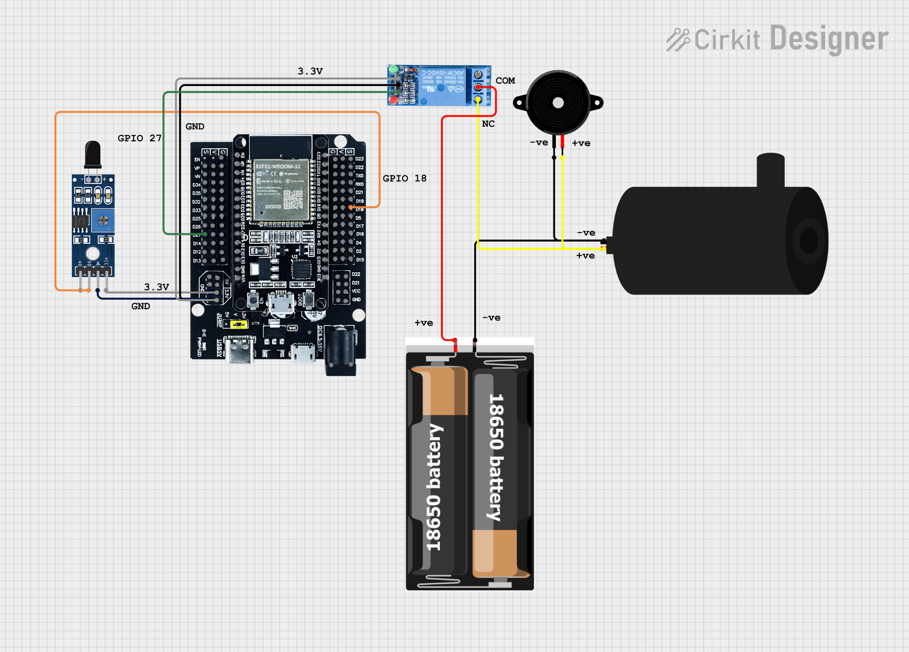
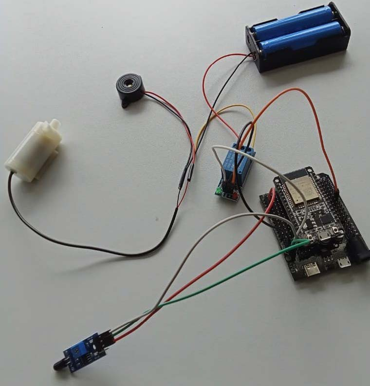

# ESP32 Flame Detection & Water Pump Control

An Arduino-based ESP32 prototype that monitors a **digital flame sensor** and activates a **relay-controlled water pump** when a flame is detected.

## Features

- Detects flame conditions using a digital flame sensor.
- Turns on an active-LOW relay when the sensor reports flame detection.
- Switches the relay off when no flame is detected.
- Shows the sensor reading and system status in the Serial Monitor.
- Reads the sensor every 100 milliseconds.

## Hardware

- ESP32 development board
- Digital flame sensor module (with a digital output pin)
- Active-LOW relay module compatible with ESP32 3.3 V control signals
- Water pump and an appropriate separate power source
- Jumper wires and other circuit components appropriate for the selected devices

## Pin Connections

| Component | ESP32 pin | Notes |
| --- | --- | --- |
| Flame sensor digital output (DO) | GPIO 27 | Code assumes LOW means flame detected |
| Relay control input (IN) | GPIO 18 | Code assumes LOW enables the relay |
| Sensor/relay ground | GND | Connect grounds as required by your hardware design |

**Power and voltage:** Check your modules' specifications before connecting power. ESP32 GPIO pins are **not 5 V tolerant**, so the flame sensor's digital output must not exceed the safe ESP32 input voltage. Use a relay module with a suitable input interface and power the pump according to its rated requirements. Do not power the pump directly from an ESP32 GPIO pin.

## How It Works

1. The ESP32 starts serial communication at **115200 baud** and sets GPIO 18 HIGH to keep an active-LOW relay off at startup.
2. The ESP32 reads the flame sensor's digital output at GPIO 27.
3. When the input is **LOW**, the code treats that as flame detected and pulls GPIO 18 LOW to activate the relay.
4. Otherwise, GPIO 18 is set HIGH, turning the relay off.
5. The system repeats after a 100 ms delay.

> **Note:** Sensor and relay logic levels vary by module. Verify your devices' active levels before running the pump. The sensitivity threshold on some flame sensors can be adjusted using the module's potentiometer.

## Upload Using Arduino IDE

1. Install Arduino IDE and the ESP32 board package.
2. Open `Project_flame_1.ino` with Arduino IDE.
3. Select your ESP32 board and the correct serial port.
4. Upload the sketch.
5. Open the Serial Monitor at **115200 baud** to view the sensor reading and status messages.

The sketch uses ESP32/Arduino core functions only; it does not require a separate third-party library.

## Example Serial Output

When a flame is detected:

```text
Sensor Value: 0
Flame Detected! Activating pump.
```

When no flame is detected:

```text
Sensor Value: 1
No Flame Detected.
```

## File Structure

```text
ESP32-Flame-Detection-Water-Pump/
├── Project_flame_1.ino
├── README.md
├── .gitignore
└── UPLOAD_TO_GITHUB.md
```

## Limitations and Safety

- This code controls **one relay output only**. It does not control a buzzer; the original sketch's serial message referring to a buzzer was corrected without changing the program logic.
- This is a **learning/prototyping project**, not a certified fire detection or fire suppression system. Do not rely on it for life safety.
- A relay and pump involve electrical and mechanical risks. Use suitable protective circuitry, wiring and power supplies. Avoid working with mains voltages without qualified supervision.
- Hardware behavior has **not been independently tested** as part of this repository preparation.

- ## Circuit Diagram


## Physical Prototype

